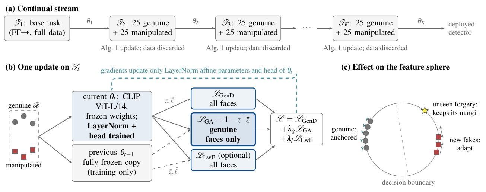
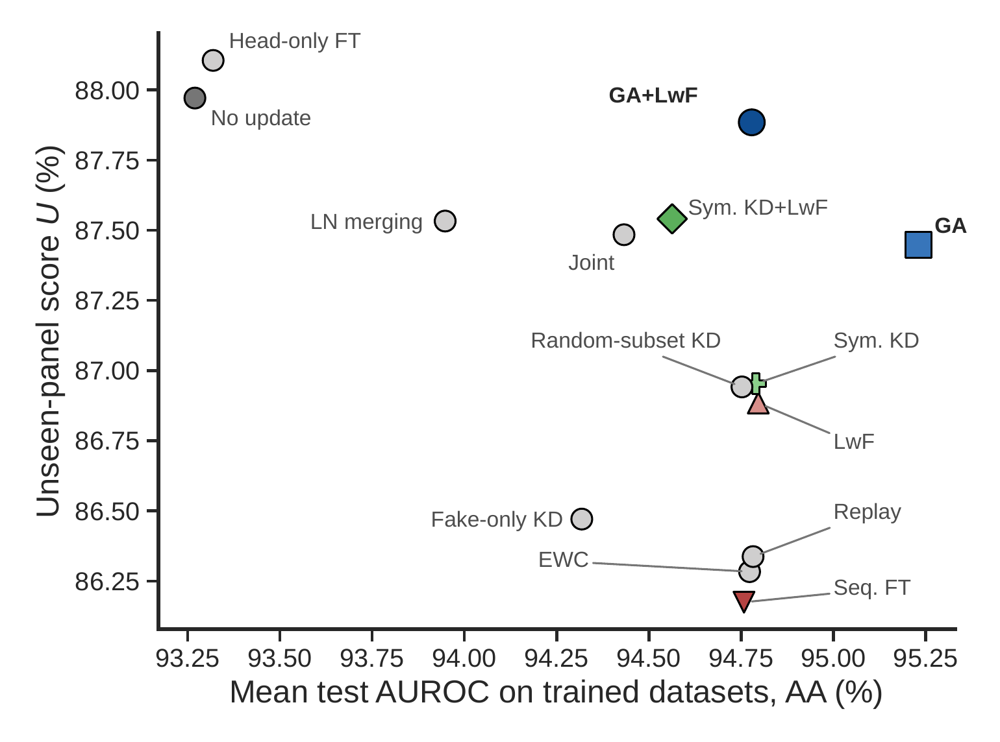
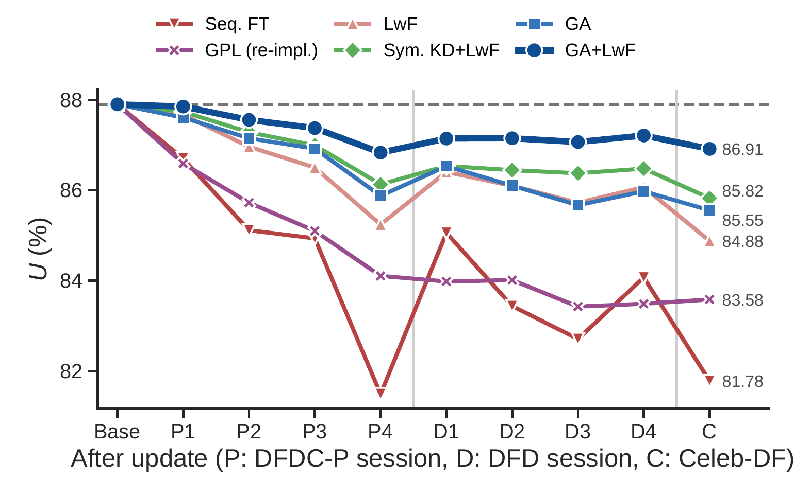

<div align="center">

# Protecting Generalization in Continually Updated Deepfake Detectors

**Naren Medarametla, Ramineni Durga Sai Sumanth, Kowsigan M**

School of Computer Science and Engineering, Vellore Institute of Technology, Chennai

</div>

<p align="center">
  
</p>

## Overview

Deepfake detectors built on foundation models generalize well to forgeries they were never trained on, but new
forgeries keep appearing and a deployed detector has to be updated with a few examples of them. We show that
few-shot updates of [GenD](https://github.com/yermandy/GenD), a CLIP ViT-L/14 detector that tunes only its
LayerNorm parameters, barely affect the datasets it learns but erode its detection of unseen forgeries.

We adapt **genuine-sample alignment (GA)**, introduced for continual fake-audio detection
(DFWF, Ma et al., Interspeech 2021), which keeps the previous model's
features of genuine faces fixed while features of manipulated faces are free to change, and combine it with logit
distillation (LwF). The update stores no past data and leaves inference unchanged.

## Main results

Five training seeds on the stream FaceForensics++ → DFDC-Preview → DFD → Celeb-DF. **Unseen** is the AUROC on two
sealed datasets that no model saw (WildDeepfake and DeepFakeFace); **Trained** is the mean test AUROC on the four
datasets of the stream.

| Method | Unseen (AUROC) | Trained (AUROC) |
|---|---|---|
| No update | 87.97 | 93.27 |
| Sequential fine-tuning | 85.20 ± 0.70 | 94.84 ± 0.26 |
| LwF | 86.80 ± 0.15 | 94.79 ± 0.11 |
| GPL (re-implemented) | 85.32 ± 0.57 | 94.25 ± 0.48 |
| GA | 87.17 ± 0.21 | **95.29 ± 0.14** |
| **GA + LwF** | **87.78 ± 0.17** | 94.84 ± 0.15 |

GA + LwF learns the new datasets as well as fine-tuning while staying within 0.2 points of the never-updated detector
on unseen forgeries. The advantage holds across task orders, a second encoder, image degradations and matched
plasticity, and grows over a stream of nine updates.

<p align="center">
  
  
</p>

## Installation

```bash
git clone https://github.com/NarenTheNumpkin/Protecting-Generalization-in-Continually-Updated-Deepfake-Detectors.git
cd Protecting-Generalization-in-Continually-Updated-Deepfake-Detectors
pip install -r requirements.txt
./setup_gend.sh                                  # clones GenD into third_party/GenD
pip install -r third_party/GenD/requirements.txt
```

Tested with Python 3.12, PyTorch 2.8 and CUDA 12.8 on a single RTX 5060 Ti (16 GB).

## Quick start: demo

The demo scores face images with the original detector and the detectors after plain fine-tuning and after GA + LwF.
The weights in `demo/weights` (0.4 MB each) hold only the parameters that differ from the released GenD model.

```bash
cd demo
python demo.py --images path/to/images --detect   # --detect finds and aligns the face in ordinary photos
```

See [`demo/README.md`](demo/README.md) for details.

## Reproducing the experiments

**Data.** FaceForensics++ (with DFD), DFDC-Preview, Celeb-DF v2, WildDeepfake and DeepFakeFace are not included;
request them from their owners and extract faces with the scripts in `experiments/scripts/preprocessing/`. The exact
identity-disjoint splits are in `experiments/registration/`. Paths are set in `experiments/paths.py` and can be
overridden with environment variables (`GEND_ROOT`, `GEND_DATASETS`, `GEND_INIT_CKPT`).

**Training and evaluation.** From `experiments/`:

```bash
python stream.py --method realkd_lwf --seed 0 --init "$GEND_INIT_CKPT" --eval-role test --panel
```

| `--method` | Method |
|---|---|
| `realkd_lwf` | GA + LwF |
| `realkd` | GA |
| `seq` | Sequential fine-tuning |
| `lwf` | Learning without forgetting |
| `featkd`, `featkd_lwf` | Symmetric feature distillation (without / with LwF) |
| `ewc`, `lnmerge`, `head` | EWC, LayerNorm merging, head-only fine-tuning |
| `fakekd`, `randkd` | Control: distill manipulated faces / a random subset |
| `replay`, `joint` | References that store data: exemplar replay, joint training |
| `gpl` | GPL re-implementation |

Use `--stream` for other task orders and `--shots` for other few-shot sizes. The analysis scripts (`analyze_*.py`, `j*_analyze.py`,
`analysis_f.py`) produce the reported tables and statistics; `results/` holds their summaries.

## Repository structure

```
experiments/   training (stream.py), shared utilities (common.py), analysis scripts
  registration/  pre-registered protocols, split manifests and their SHA-256 hashes
  scripts/       run scripts for each stage and face-extraction scripts
demo/          detection demo and model weights
paper/         LaTeX sources of the paper and supplement, figure scripts
results/       result summaries behind the paper's tables
report/        generator for the university project report
assets/        figures for this README
```

## Citation

```bibtex
@misc{medarametla2026protecting,
  title  = {Protecting Generalization in Continually Updated Deepfake Detectors},
  author = {Medarametla, Naren and Sumanth, Ramineni Durga Sai and M, Kowsigan},
  year   = {2026},
  note   = {Manuscript},
  url    = {https://github.com/NarenTheNumpkin/Protecting-Generalization-in-Continually-Updated-Deepfake-Detectors}
}
```

## Acknowledgements

This work builds on [GenD](https://github.com/yermandy/GenD) by Yermakov et al. and on the genuine-sample alignment
of DFWF (Ma et al., Interspeech 2021). Plots follow the style of
[figures4papers](https://github.com/ChenLiu-1996/figures4papers).
